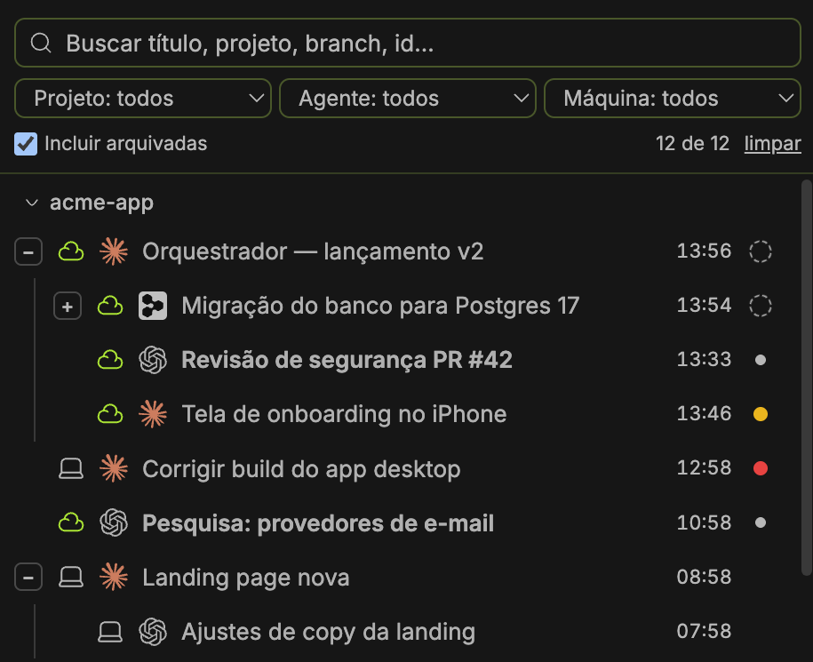

# cloudroom-bb-search-plugin

Plugin do Cloudroom que troca a lista de threads da barra lateral por uma lista com **busca e filtros**.



<sub>Imagem com dados de exemplo.</sub>

- Busca por título, projeto, agente, máquina, branch ou id (sem diferenciar acento/maiúscula; várias palavras = todas precisam bater).
- Pastas: as seções do Cloudroom aparecem como pastas dentro de cada projeto. A skill `organizar-pastas` ensina os agentes a criar pastas e mover threads.
- Tags por thread (antes da hora). Tag com chave de Task (ex.: `MX-213`) fica destacada. Agentes usam `room-cli tags add|remove|set|rename|find|all` (skill `tags-de-threads`).
- Fixadas no topo do projeto, com a árvore delas.
- Filtros retráteis (ícone ao lado da busca): Projeto, Agente, Máquina, Tag, Pasta, incluir arquivadas (busca todas as arquivadas pela API).
- Agrupado por projeto, com a mesma árvore da lista nativa: ícone de máquina (local/nuvem), threads filhas recuadas sob a mãe e setinha para abrir/fechar. Ao filtrar, a mãe de quem bateu aparece junto.
- Hora da última mensagem em cada linha (há N d se passou de 24 h).
- Clique direito abre o menu normal da thread. Filtros ficam salvos.

## Instalar

```sh
room-cli plugin install https://github.com/guilherme-vasques-ltda/cloudroom-bb-search-plugin
```

Ou de uma cópia local: `npm install && room-cli plugin build . && room-cli plugin install .`

Para voltar à lista padrão: Settings → Appearance → Sidebar.

## Desenvolver

`room-cli plugin dev .` recompila e recarrega a cada mudança.
